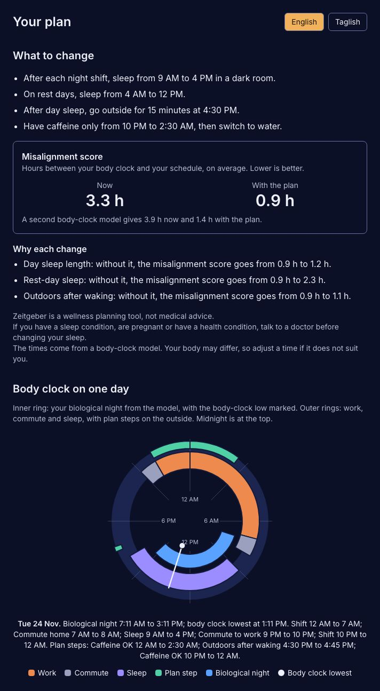
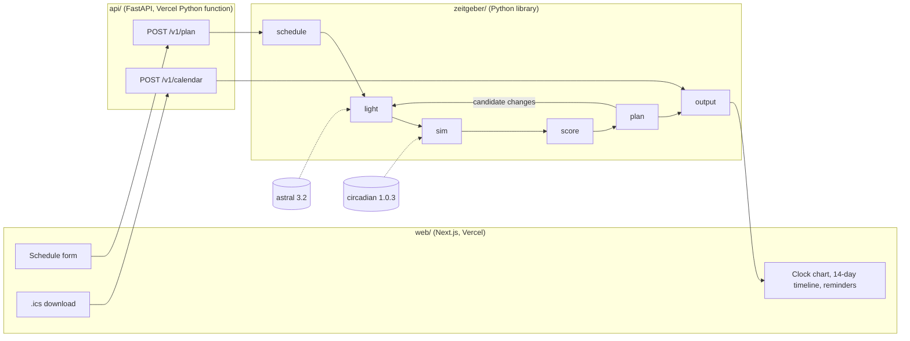
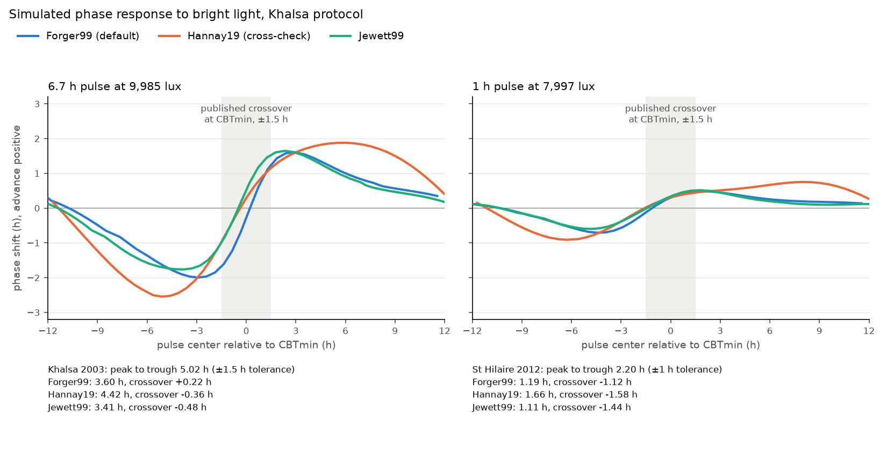

<a href="https://zeitgeber-web.vercel.app">
  <picture>
    <source media="(prefers-color-scheme: dark)" srcset="docs/figures/header-dark.svg">
    <source media="(prefers-color-scheme: light)" srcset="docs/figures/header-light.svg">
    
  </picture>
</a>

# Zeitgeber

A body-clock planner for night-shift workers: it simulates your circadian clock with published models and plans when to get light, avoid it, sleep, nap and stop caffeine around your shifts.

[](https://github.com/lauurnce/zeitgeber/actions/workflows/ci.yml)
[](LICENSE)
[](pyproject.toml)

The header is drawn from real model output for an example worker (`scripts/readme_header.py`). Click it, or open **[zeitgeber-web.vercel.app](https://zeitgeber-web.vercel.app)**, to run the planner on your own schedule.

<p align="center">
  
</p>

## Why

About 1.9 million people worked in Philippine IT-BPM in 2025 ([IBPAP via Philstar, 29 January 2026](https://www.philstar.com/business/2026/01/29/2504140/it-bpm-revenues-breach-40-billion-mark)), and many of them work through the Manila night for customers in other time zones. Their shifts end around sunrise, so the brightest light of the day hits them on the commute home and tells the body clock it is morning just before they try to sleep. Zeitgeber turns a worker's own schedule into a short, concrete plan for light, sleep and caffeine, built on the same models and field studies that shift-work researchers use.

## The name

*Zeitgeber* is German for "time giver": an outside cue, sunlight above all, that sets the body clock. The physiologist Jürgen Aschoff used the word in 1954. With Rütger Wever he had a windowless bunker built in Andechs, Bavaria, and went in first. Cut off from daylight and clocks, volunteers drifted to days of about 25 hours ([Aschoff 1965, Science](https://doi.org/10.1126/science.148.3676.1427)). Night-shift workers get their strongest Zeitgeber at the wrong hour.

## Quickstart

Needs [uv](https://docs.astral.sh/uv/) and Python 3.12.

```sh
git clone https://github.com/lauurnce/zeitgeber.git
cd zeitgeber
uv sync --extra api
```

### Python

```python
import json
from datetime import UTC, datetime

from zeitgeber.output import plan_document
from zeitgeber.output.plan import render_timeline
from zeitgeber.plan import search
from zeitgeber.schedule import Schedule

data = json.load(open("tests/fixtures/schedules/permanent_nights.json"))
data.pop("description")
result = search(Schedule.model_validate(data))  # about 6 s on a laptop
doc = plan_document(result, datetime.now(UTC))
print(render_timeline(doc))
```

Output (first lines):

```text
Your 14-day plan from Mon 16 Nov
All times are Philippine time.
Zeitgeber is a wellness planning tool, not medical advice.
...

What to change
- Wear dark sunglasses (category 3) on the commute home whenever the sun is up.
- After each night shift, sleep from 9 AM to 4 PM in a dark room.
- On rest days, sleep from 4 AM to 12 PM.
- After day sleep, go outside for 15 minutes at 4:30 PM.
- Have caffeine only from 10 PM to 2:30 AM, then switch to water.

Misalignment score: 3.7 h now, 1.0 h with the plan. Lower is better.
A second body-clock model gives 4.9 h now and 1.5 h with the plan.

Why
- Sunglasses on the way home: without it, the misalignment score goes from 1.0 h to 1.2 h.
- Day sleep length: without it, the misalignment score goes from 1.0 h to 1.2 h.
- Rest-day sleep: without it, the misalignment score goes from 1.0 h to 2.3 h.
- Outdoors after waking: without it, the misalignment score goes from 1.0 h to 1.1 h.

Day by day

Mon 16 Nov
  4 AM to 12 PM                 Rest-day sleep  [new]
  8:30 PM to 10 PM              Commute to work
  10 PM to 7 AM (next day)      Shift
  10 PM to 2:30 AM (next day)   Caffeine OK  [new]
  Body clock lowest around 1:45 PM
```

### HTTP API

The same plan from the deployed API ([docs/API.md](docs/API.md)); run it locally with `make api-dev`.

```sh
python3 -c "import json; d = json.load(open('tests/fixtures/schedules/permanent_nights.json')); \
  d.pop('description'); print(json.dumps({'schedule': d}))" > plan-request.json
curl -s -X POST https://zeitgeber-five.vercel.app/v1/plan \
  -H 'content-type: application/json' --data @plan-request.json \
  | jq '{plan_id, score: {now: .score.baseline.total_h, plan: .score.plan.total_h},
         first_nudge_tl: .nudges[1].text.tl}'
```

```json
{
  "plan_id": "a1527b6bb437",
  "score": { "now": 3.69, "plan": 1.036 },
  "first_nudge_tl": "2:30 AM ang huling kape mo. Tubig na lang pagkatapos, para madali kang makatulog pag-uwi."
}
```

That request took 22.6 s on the deployed function (see Limitations). `POST /v1/calendar` turns the returned plan into an .ics file, and `POST /v1/simulate` returns the predicted body-clock low per day.

## How it works



**Schedule.** The worker enters shifts per weekday, both commutes (length, share outdoors, how they travel), when they sleep now after shifts and on rest days, and a start date. The schedule is validated into plain-word errors (a sleep that starts before you get home, a shift of 16 hours) and expanded into 14 days of intervals in UTC.

**Light.** Each interval becomes light at the eye, every 0.1 h: office light during shifts, darkness in sleep, outdoor sunlight or shade on the commute while the sun is up (sunrise and sunset for the location from astral), and dim light at home at night. Every lux value is a cited constant in [docs/SCIENCE.md](docs/SCIENCE.md) 3.5.

**Simulation.** The light profile drives a published model of the human circadian pacemaker, Forger99 by default, through the open-source [circadian](https://github.com/Arcascope/circadian) package. The model is first run on the current schedule until it settles, then on the next 14 days, and the daily low of core body temperature (CBTmin) is read off the result. Hannay19 runs alongside as a cross-check.

**Score.** For each main sleep, the score measures how far CBTmin sits from where it should be (about two hours before waking) and adds half the hours of work inside the two-hour window around CBTmin, the time of the strongest sleepiness. The mean over the 14 days is the misalignment score, in hours; lower is better.

**Plan.** The planner tries changes from published shift-work strategies: sunglasses on the commute home, the time and length of day sleep, a late rest-day sleep window, 15 minutes outdoors after waking, bright light early in the shift, a pre-shift nap and a caffeine cutoff. Hard rules (no sleep during a shift or a commute, no very dark lenses for drivers, at least 7 hours of day sleep) bound the search. A seeded coordinate descent with restarts, run in batches, keeps the plan with the lowest score; the same schedule and seed always give the same plan. Each recommended change is then removed on its own and the plan re-simulated, so every change shows what it is worth.

**Output.** The plan becomes a versioned JSON document, a text timeline, an iCalendar file with reminders in Manila time, and nudges in English and Taglish from one reviewed string catalog. Optional rewording by a language model is off by default and rejected whenever it adds a time, a number or a medical term.

**API and web.** The API is stateless: each schedule is processed in memory and dropped, request bodies are never logged, and the web app keeps the plan in the page only.

## The science

| Model | Source | Role |
|---|---|---|
| Forger99 | Forger, Jewett and Kronauer 1999 | default model for planning |
| Jewett99 | Jewett, Forger and Kronauer 1999 | compared in the tests |
| Hannay19 | Hannay, Booth and Forger 2019 | cross-check shown next to every plan |

The models are checked against human phase response curves: how much a pulse of bright light moves the clock, depending on when it comes. The figure is Zeitgeber's reproduction of the protocols of Khalsa et al. 2003 (6.7 h at about 10,000 lux) and St Hilaire et al. 2012 (1 h at about 8,000 lux), with `scripts/reproduce_prc.py`.

<p align="center"></p>

The planner's rules come from field and laboratory studies of night work. The main sources:

- Forger DB, Jewett ME, Kronauer RE (1999). A simpler model of the human circadian pacemaker. *Journal of Biological Rhythms* 14: 532-537. https://doi.org/10.1177/074873099129000867
- Jewett ME, Forger DB, Kronauer RE (1999). Revised limit cycle oscillator model of human circadian pacemaker. *Journal of Biological Rhythms* 14: 493-499. https://doi.org/10.1177/074873049901400608
- Hannay KM, Booth V, Forger DB (2019). Macroscopic models for human circadian rhythms. *Journal of Biological Rhythms* 34: 658-671. https://doi.org/10.1177/0748730419878298
- Khalsa SBS, Jewett ME, Cajochen C, Czeisler CA (2003). A phase response curve to single bright light pulses in human subjects. *Journal of Physiology* 549: 945-952. https://doi.org/10.1113/jphysiol.2003.040477
- St Hilaire MA et al. (2012). Human phase response curve to a 1 h pulse of bright white light. *Journal of Physiology* 590: 3035-3045. https://doi.org/10.1113/jphysiol.2012.227892
- Crowley SJ, Lee C, Tseng CY, Fogg LF, Eastman CI (2003). *Journal of Biological Rhythms* 18: 513-523. https://doi.org/10.1177/0748730403258422
- Smith MR, Fogg LF, Eastman CI (2009). A compromise circadian phase position for permanent night work improves mood, fatigue, and performance. *Sleep* 32: 1481-1489. https://doi.org/10.1093/sleep/32.11.1481
- Smith MR, Eastman CI (2012). Shift work: health, performance and safety problems, traditional countermeasures, and innovative management strategies to reduce circadian misalignment. *Nature and Science of Sleep* 4: 111-132. https://doi.org/10.2147/NSS.S10372
- Drake C, Roehrs T, Shambroom J, Roth T (2013). Caffeine effects on sleep taken 0, 3, or 6 hours before going to bed. *Journal of Clinical Sleep Medicine* 9: 1195-1200. https://doi.org/10.5664/jcsm.3170

Every model, constant, light level and rule, with its source and whether it could be checked, is in [docs/SCIENCE.md](docs/SCIENCE.md). Values that could not be checked are marked UNVERIFIED there.

## Validation

What the 341 Python tests, 25 component tests and the Playwright tests check, on every push in CI:

- **Models against published results.** All three models reproduce the direction of the light response (evening light delays, morning light advances), the crossover within 1.5 h of CBTmin, and a CBTmin 1 to 4 hours before waking on a normal day. A 1-minute step moves CBTmin by less than 0.1 h compared with the 0.1 h step used for plans.
- **Planner rules.** No plan ever puts sleep or a nap inside a shift or a commute, caffeine always stops 6 h (or 8 h) before sleep, drivers are never offered very dark lenses, the same seed always gives the same plan, and every explanation matches a fresh re-simulation.
- **Outputs.** The plan document validates against its JSON schema, the calendar file parses back event for event with the right Manila times and reminders, the grounding check rejects an invented time, number or medical term, and golden files pin the text for three example workers.
- **API.** Every response matches the published OpenAPI schema; errors, size limits, CORS, rate limits and log scrubbing are tested, including that no schedule detail reaches a log.
- **Web.** Keyboard-only use of the form, labels on every control, text equivalents for the charts, no browser storage of the schedule, no sideways scrolling at 360 px, and an end-to-end run from the form to the downloaded calendar.

The phase response amplitudes are where the models fall short of the published data:

| Peak-to-trough shift | Published | Forger99 | Jewett99 | Hannay19 |
|---|---|---|---|---|
| 6.7 h pulse | 5.02 h (Khalsa 2003) | 3.60 h | 3.41 h | 4.42 h |
| 1 h pulse | 2.20 h (St Hilaire 2012) | 1.19 h | 1.11 h | 1.66 h |
| ratio 1 h to 6.7 h | about 0.40 | 0.33 | 0.33 | 0.38 |

The published values come from a hormone rhythm measured in blood and the simulated ones from CBTmin, and the published dim-light conditions differ from the package's protocol, so part of the gap may be measurement rather than model; [docs/SCIENCE.md](docs/SCIENCE.md) 4.6 has the details. Whether plans help real workers is a separate question: the [pilot protocol](docs/PILOT_PROTOCOL.md) sets out a three-week study with 10 to 15 BPO agents, written before any data was collected, including what result would count as no effect.

## Limitations

- **Wellness tool, not medical advice.** If you often cannot sleep or cannot stay awake, nod off at work or on the road, are pregnant, or have a health condition, talk to a doctor.
- **A model of an average adult, fed with estimates.** Light levels come from published typical values, not measurements of your room, office or commute. Your body clock may run earlier or later than the model's.
- **Not validated on real workers yet.** The pilot has not run. For the example worker the model places the body-clock low later than field studies of night workers suggest (docs/SCIENCE.md 5.7).
- **Slow.** A plan takes about 22 seconds on the deployed function, against a target of 6 seconds.
- **Weekly schedules only.** Rotating shifts that change every week are not modelled, and for the rotating example the planner finds nothing better than the current schedule.
- **Taglish is a draft.** The Taglish text waits for review by a native speaker.

## Roadmap

v0.2:

- **Wearables:** read sleep and light data from a watch or a light sensor instead of estimating them.
- **Rotating-shift presets:** common BPO rotations, and planning across the change from one rotation to the next.
- **Employer view:** anonymous, aggregate scheduling insights for wellness and HR teams, with no individual data.

## License

MIT. See [LICENSE](LICENSE) and [THIRD_PARTY_NOTICES.md](THIRD_PARTY_NOTICES.md). To cite Zeitgeber, see [CITATION.cff](CITATION.cff).

Built by [Lawrence Panes](https://lauurnce.is-a.dev).
