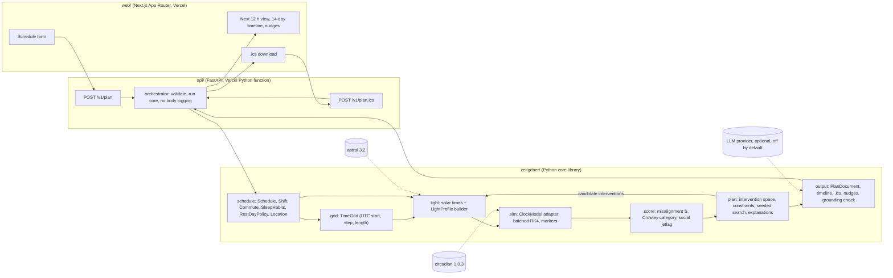

# Zeitgeber architecture

This document describes how the pieces of Zeitgeber fit together, the public interfaces between them, the runtime decision and the numbers behind it, the planner design, the testing strategy, tooling, risks and the build plan. Science inputs (models, constants, rules) are defined in docs/SCIENCE.md and are referenced here by section number.

Conventions: times inside the core are timezone-aware UTC `datetime` values or hours as `float` on a uniform grid; light is photopic lux; phase is radians; durations in hours unless a name says minutes.

## 1. System diagram



Data flow for one request: the web form posts a `Schedule`; the API validates it and calls the core; the core builds the baseline light profile, equilibrates the model on the current habits, scores the baseline, searches the intervention space (each candidate is a new light profile simulated in a batch), explains the chosen interventions by ablation, and renders a `PlanDocument`; the API returns JSON or an .ics file; nothing is stored.

## 2. Modules and public interfaces

Package layout (distribution name `zeitgeber-core`, import name `zeitgeber`):

```
zeitgeber/
  schedule.py   # input models and validation
  grid.py       # TimeGrid shared by light and sim
  light.py      # solar times, lux constants, LightProfile builder
  sim.py        # ClockModel protocol, package adapters, batched integration, markers
  score.py      # misalignment score (SCIENCE 7)
  plan.py       # intervention space, constraints, search, explanations (SCIENCE 5, 6, 7)
  output.py     # PlanDocument, timeline, .ics, nudges, grounding check, rewriter protocol
  settings.py   # runtime settings (model, language, llm_wording, provider)
api/            # FastAPI app and Vercel function entry
web/            # Next.js planner and landing page
scripts/        # benchmarks and one-off tools
```

Changes from the starting proposal are marked "change" and explained in place.

### 2.1 zeitgeber/schedule

```python
class Location(BaseModel):                      # change: added; light depends on it
    name: str
    latitude: float                             # degrees, -72 to 72
    longitude: float                            # degrees, -180 to 180
    timezone: str = "Asia/Manila"               # IANA name

class Shift(BaseModel):
    weekday: int                                # 0 = Monday; the local day the shift starts
    start: time                                 # local wall clock
    end: time                                   # local; earlier than start means it crosses midnight

class Commute(BaseModel):
    duration_min: int                           # 0 to 300
    outdoor_min: int                            # 0 to duration_min; counted as daylight only when the sun is up
    mode: Literal["walk", "jeepney_bus", "train", "car_driver", "car_passenger", "motorcycle"]
    @property
    def drives(self) -> bool                    # car_driver or motorcycle; gates the dark-lens rule (R2)

class SleepHabits(BaseModel):                   # change: added; current behaviour defines the burn-in
    workday_sleep_start: time
    workday_sleep_end: time
    restday_sleep_start: time
    restday_sleep_end: time
    phone_in_bed_min: int = 0                   # light at 30 lux before sleep (SCIENCE 3.5)

class RestDayPolicy(BaseModel):
    weekdays: list[int]                         # rest days, 0 = Monday
    keep_night_schedule: bool = False           # True: the worker already sleeps late on rest days

class Schedule(BaseModel):
    anchor_date: date                           # local date of the first planned day
    plan_days: int = 14
    location: Location
    shifts: list[Shift]                         # at most one per weekday
    commute_to_work: Commute                    # change: both commutes modeled
    commute_home: Commute
    sleep: SleepHabits
    rest_days: RestDayPolicy

    def materialize(self) -> list[Interval]:    # absolute UTC intervals for burn-in and plan days

@dataclass(frozen=True)
class Interval:
    start: datetime                             # UTC, timezone-aware
    end: datetime
    kind: Literal["shift", "commute_to_work", "commute_home", "sleep", "rest_sleep", "nap", "light_seek", "light_brake"]
    day_index: int                              # 0-based plan day the interval belongs to
```

Validation: at most one shift per weekday; shift length 4 to 14 h; rest days are the weekdays without shifts unless listed; `outdoor_min <= duration_min`; sleep windows 3 to 12 h; latitude within 72 degrees (SCIENCE 9.5); timezone resolvable. `materialize` is the only place that turns wall-clock times into UTC, so midnight crossing is handled once.

Change: the rest-day sleep window is a planner parameter (rule R4), so `RestDayPolicy` carries only which days are rest days and whether the worker already keeps a late schedule; the current rest-day sleep times live in `SleepHabits` for the burn-in.

### 2.2 zeitgeber/grid (change: added)

```python
@dataclass(frozen=True)
class TimeGrid:
    start: datetime                             # UTC
    step_h: float                               # 0.1 for search, 1/60 for verification
    n: int
    def hours(self) -> np.ndarray               # shape (n,), hours since start
    def index(self, t: datetime) -> int
    def at(self, i: int) -> datetime
    def mask(self, interval: Interval) -> np.ndarray   # boolean (n,)
```

Light arrays, trajectories and markers all carry the grid they were computed on, so arrays cannot be mixed by accident.

### 2.3 zeitgeber/light

```python
class LuxConstants(BaseModel):                  # values from SCIENCE 3.5, all named so tests can scale them
    outdoor_sun: float = 10_000
    shade_or_vehicle: float = 1_000
    office: float = 500
    home: float = 100
    home_dim_phone: float = 30
    sleep: float = 1
    night_street: float = 10
    sunglasses: dict[str, float] = {"none": 1.0, "cat3": 0.15, "dark": 0.02}
    light_seek: float = 1_000

@dataclass(frozen=True)
class SolarTimes:
    dawn: datetime; sunrise: datetime; noon: datetime; sunset: datetime; dusk: datetime   # UTC

def solar_times(location: Location, day: date) -> SolarTimes          # astral 3.2 (SCIENCE 9)
def sun_up(location: Location, grid: TimeGrid) -> np.ndarray          # boolean (n,), cached per date

@dataclass(frozen=True)
class LightProfile:
    grid: TimeGrid
    lux: np.ndarray                             # (n,) or (n, batch)
    labels: np.ndarray                          # int8 environment codes, (n,) or (n, batch)

def build_light_profile(schedule: Schedule, grid: TimeGrid,
                        interventions: Interventions | None = None,
                        constants: LuxConstants = LuxConstants()) -> LightProfile
def build_light_batch(schedule: Schedule, grid: TimeGrid,
                      candidates: Sequence[Interventions],
                      constants: LuxConstants = LuxConstants()) -> LightProfile   # lux shape (n, len(candidates))
```

Change: interventions are applied inside the light builder. Sunglasses scale outdoor samples, a light-seeking window overrides office samples, naps and sleep windows set dark samples, and the light brake inserts an outdoor block. The planner never edits lux arrays, so baseline and candidate profiles are built by the same code and tested once. Labels record which environment produced each sample, which the explanations and timeline use.

### 2.4 zeitgeber/sim

```python
class ClockModel(Protocol):
    name: str                                   # "forger99", "jewett99", "hannay19"
    n_states: int
    def derivative(self, t_h: float, state: np.ndarray, lux: np.ndarray) -> np.ndarray   # state (n_states, batch)
    def default_state(self) -> np.ndarray
    def cbt_min_hours(self, hours: np.ndarray, states: np.ndarray) -> np.ndarray          # per batch column
    def dlmo_hours(self, hours: np.ndarray, states: np.ndarray) -> np.ndarray             # cbt minus 7 h (SCIENCE 1.6)

class ForgerAdapter: ...    # wraps circadian.models.Forger99; the only module that imports the package
class JewettAdapter: ...
class HannayAdapter: ...

@dataclass(frozen=True)
class Trajectory:
    grid: TimeGrid
    states: np.ndarray                          # (n, n_states, batch)

@dataclass(frozen=True)
class Markers:
    cbt_min: list[np.ndarray]                   # one array of UTC hours-since-grid-start per batch column
    dlmo: list[np.ndarray]

def integrate(model: ClockModel, grid: TimeGrid, lux: np.ndarray, state0: np.ndarray) -> Trajectory
def equilibrate(model: ClockModel, grid: TimeGrid, lux: np.ndarray,
                loops: int = 6, tol_h: float = 0.05) -> np.ndarray      # returns state (n_states,)
def markers(model: ClockModel, trajectory: Trajectory) -> Markers
```

Change: `integrate` is a batched fixed-step RK4 loop that calls the package's `derv` through the adapter, instead of the package's own `integrate`. The package loop handles one light array at a time and takes 76 ms per 14-day candidate on the development Mac; the batched loop takes 0.9 ms per candidate with bit-identical states (section 3). The package's `integrate` remains the reference in parity tests.

Change: `equilibrate` declares convergence when every daily CBTmin moved by less than `tol_h` between the last two loops, not when the last DLMO moved by less than 0.001 h. The package's check warned after 3 loops in the benchmark; the weekly schedule needs about 6 loops of 14 days.

### 2.5 zeitgeber/score

```python
@dataclass(frozen=True)
class DayScore:
    day_index: int
    mid_sleep_h: float; cbt_min_h: float | None
    delta_h: float; target_h: float; misalignment_h: float      # Delta_d, t_d, M_d (SCIENCE 7.3)
    shift_overlap_h: float                                       # P_d
    category: Literal["not", "partial", "complete", "no_marker"]

@dataclass(frozen=True)
class ScoreBreakdown:
    total_h: float                              # S
    days: list[DayScore]
    social_jetlag_h: float
    lam: float

def score(markers: Markers, sleep: list[Interval], shifts: list[Interval],
          lam: float = 0.5, target_before_wake_h: float = 2.0) -> ScoreBreakdown
def wrap_hours(delta_h: float) -> float          # into (-12, 12]
```

### 2.6 zeitgeber/plan

```python
class Interventions(BaseModel):                 # one candidate plan; defaults are "do nothing"
    sleep_start_offset_h: float = 0.0           # after arriving home, 0 to 1.5 step 0.5 (R3)
    sleep_len_h: float = 7.0                    # 7 to 9 step 1 (R3)
    sunglasses: Literal["none", "cat3", "dark"] = "none"    # R2; "dark" only when not driving
    light_seek_start_h: float | None = None     # hours after shift start, step 1 (R1)
    light_seek_len_h: float = 0.0               # 0, 0.5, 1.0 (R1)
    light_brake: bool = False                   # R5
    rest_sleep_start: time = time(1, 0)         # 01:00 to 04:00 step 1 h, 8 h long (R4)
    nap_len_min: int = 0                        # 0, 30, 60, 90, ending 30 min before leaving (N1)
    nap_before_shift_h: float = 3.0             # fixed in v0.1
    @property
    def caffeine_cutoff_before_sleep_h(self) -> float   # 6, or 8 when slow clearance is reported (C1, C2)

class InterventionSpace:
    def __init__(self, schedule: Schedule) -> None
    def options(self, name: str) -> list[Any]           # allowed values per parameter for this schedule
    def feasible(self, c: Interventions) -> bool         # static constraints (driving, nap fits the gap)

@dataclass(frozen=True)
class Violation:
    rule_id: str; detail: str; hard: bool

class Constraints:
    def check(self, c: Interventions, markers: Markers, schedule: Schedule) -> list[Violation]   # SCIENCE 5.4 and 6.3

@dataclass(frozen=True)
class SearchConfig:
    seed: int = 0
    passes: int = 4
    restarts: int = 8
    step_h: float = 0.1                         # request path; 1/60 only in tests (section 3.4)
    lam: float = 0.5
    burden_h: float = 0.05
    model: str = "forger99"
    cross_check: str | None = "hannay19"

@dataclass(frozen=True)
class Explanation:
    intervention: str; rule_ids: list[str]
    delta_score_h: float                        # score without it minus score with it
    delta_cbt_day7_h: float; delta_cbt_day14_h: float

@dataclass(frozen=True)
class PlanResult:
    baseline: ScoreBreakdown; chosen: Interventions; score: ScoreBreakdown
    markers_baseline: Markers; markers_plan: Markers
    cross_check: Markers | None                 # Hannay19 on the final plan only
    explanations: list[Explanation]
    evaluations: int; seed: int

def search(schedule: Schedule, config: SearchConfig = SearchConfig()) -> PlanResult
def explain(schedule: Schedule, chosen: Interventions, config: SearchConfig) -> list[Explanation]
```

Change: the request path runs at the 0.1 h step throughout; the 1 min step is used only in tests that bound the difference (section 3.4).

Change: the cross-check model runs on the baseline and the final plan only, not on every candidate. Hannay19 costs about 2.5 times Forger99 per step (section 3) and its job is a second opinion, not a search objective.

### 2.7 zeitgeber/output

```python
class PlanEvent(BaseModel):
    kind: Literal["sleep", "nap", "sunglasses", "light_seek", "light_brake", "caffeine_cutoff", "shift", "commute"]
    start_utc: datetime; end_utc: datetime
    start_local: str; end_local: str            # "HH:MM" in the schedule timezone
    rule_id: str | None
    text_en: str; text_tl: str
    numbers: dict[str, float]                   # every number that appears in the texts

class PlanDay(BaseModel):
    date: date; label: str                      # "Night of Tue to Wed"
    events: list[PlanEvent]
    cbt_min_local: str | None; category: str

class PlanDocument(BaseModel):
    version: str; generated_at: datetime; timezone: str; language: Literal["en", "tl"]
    days: list[PlanDay]
    score: ScoreBreakdown; baseline_score: ScoreBreakdown
    explanations: list[Explanation]
    cross_check_note: str | None
    disclaimers: list[str]                      # wellness framing, doctor referral

def render_timeline(doc: PlanDocument) -> list[dict]          # rows for the web timeline
def render_ics(doc: PlanDocument, alarms: bool = True) -> bytes   # one VEVENT per event, VALARM, TZID
def render_nudges(doc: PlanDocument, lang: Literal["en", "tl"]) -> list[str]

class GroundingCheck:
    banned_terms: tuple[str, ...]               # melatonin, dose, disorder, treat, cure, diagnose, and translations
    def numbers_in(self, text: str) -> set[str]
    def passes(self, text: str, allowed: set[str]) -> bool   # no new numbers or times, no banned term

class Rewriter(Protocol):
    def rewrite(self, text: str, tone: str, lang: str) -> str

class AnthropicRewriter: ...                     # provider adapter; enabled only when settings.llm_wording is true

def finalize_nudge(template_text: str, allowed_numbers: set[str],
                   rewriter: Rewriter | None, check: GroundingCheck) -> str   # falls back to the template
```

Change: the grounding check is its own class with the banned-term list, and the language-model provider sits behind a `Rewriter` protocol so the product never names a vendor outside `settings.py`.

### 2.8 api/

- `GET /v1/health` returns version and model names.
- `POST /v1/plan` takes `{schedule: Schedule, options: {model, language, llm_wording}}` and returns `PlanDocument`.
- `POST /v1/plan.ics` takes the same body and returns `text/calendar`.
- Body limit 32 KB, request timeout 25 s, CORS for the web origin only, errors as problem JSON (RFC 9457), access log without bodies or query strings, no cookies, no persistence.
- Entry point `api/index.py` for the Vercel Python runtime; the same ASGI app runs under Mangum on Lambda if hosting changes (section 3).

### 2.9 web/

- Routes: `/` landing page, `/plan` planner (form, next 12 h view, 14-day timeline, nudges, .ics download), `/science` summary with links to docs/SCIENCE.md.
- Form presets for common BPO shifts and copy-to-all weekdays; English and Taglish toggle.
- Calls `/api/v1/plan` on the same deployment; keeps the plan in memory only; no analytics on form inputs.
- Mobile-first; the next 12 h view is the default on phones.

## 3. Runtime decision

### 3.1 Question

Where should the simulator and planner run: (a) a Python API on a serverless host, (b) Python in the browser with Pyodide, or (c) a TypeScript port with parity tests? The answer depends on how long one request takes, how much has to be downloaded or deployed, and how many copies of the science code must be kept correct.

### 3.2 Method

- `scripts/bench_sim.py` simulates 14 days for one schedule (3 burn-in loops, 14 days, CBTmin markers) and for 200 candidate plans, at the planning step of 0.1 h and the verification step of 1 min (SCIENCE 1.7). Candidates vary sleep start and length, sunglasses, a light-seeking hour and rest-day sleep. It times the package's own `integrate` loop and a batched RK4 loop that calls the package's `derv` for all candidates at once, and checks that both give the same states.
- The same script runs unchanged inside Pyodide 314.0.7 under Node, with numpy, scipy and matplotlib from the Pyodide distribution and fastcore and circadian 1.0.3 from PyPI through micropip.
- `scripts/bench_sim.mjs` is a 60-line JavaScript port of the Forger99 equations with the same schedule stand-in and RK4 scheme, run in Node.
- Machine: Apple M4 Pro, 12 cores, 24 GB, macOS 26.5.2, all runs single-threaded. Python 3.13.14 with numpy 2.5.4 and scipy 1.18.1; Pyodide Python 3.14.2 with numpy 2.4.6 and scipy 1.18.0; Node 24.18.0. Measured 2026-11-09.

Commands:

```
uv run --no-project --with "circadian==1.0.3" python scripts/bench_sim.py
node scripts/bench_sim.mjs
```

### 3.3 Results

Native Python, circadian 1.0.3:

| Model | Step | Work | Wall time | Per candidate |
|---|---|---|---|---|
| Forger99 | 0.1 h | one schedule: 3 burn-in loops, 14 days, markers | 0.32 s | |
| Forger99 | 0.1 h | 200 candidates, package `integrate` loop | 15.3 s | 76 ms |
| Forger99 | 0.1 h | 200 candidates, batched RK4 on package `derv` | 0.17 s | 0.9 ms |
| Forger99 | 1 min | one schedule | 1.78 s | |
| Forger99 | 1 min | 200 candidates, package loop (10 measured, extrapolated) | 91 s | 455 ms |
| Forger99 | 1 min | 200 candidates, batched | 1.02 s | 5.1 ms |
| Hannay19 | 0.1 h | one schedule | 0.52 s | |
| Hannay19 | 0.1 h | 200 candidates, package loop | 25.9 s | 130 ms |
| Hannay19 | 0.1 h | 200 candidates, batched | 0.44 s | 2.2 ms |
| Hannay19 | 1 min | 200 candidates, batched | 2.61 s | 13.0 ms |

Batched and package loops gave identical states (maximum absolute difference 0.0) for both models at both steps. CBTmin extraction for 200 candidates took 0.02 s or less. The package's `equilibrate` warned "did not equilibrate" after 3 loops, which supports the stricter convergence rule in 2.4.

Python in the browser (Pyodide 314.0.7 under Node, second run with packages cached):

| Work | Time |
|---|---|
| start the runtime | 0.86 s |
| load numpy, scipy, matplotlib, micropip | 1.01 s |
| install fastcore and circadian with micropip | 0.61 s |
| `import circadian.models` | 2.64 s |
| Forger99, 0.1 h, one schedule | 0.63 s |
| Forger99, 0.1 h, 200 candidates batched | 0.32 s (1.6 ms each) |
| Hannay19, 0.1 h, 200 candidates batched | 0.80 s (4.0 ms each) |
| download on first use: runtime 13 MB plus wheels 34 MB (scipy 14, matplotlib 7, pandas 4.2, numpy 3.0, stdlib 2.5) | about 47 MB |

States matched the package loop exactly here too.

JavaScript port of Forger99 (Node 24):

| Step | Work | Time |
|---|---|---|
| 0.1 h | one schedule | 3 ms |
| 0.1 h | 200 candidates | 41 ms (0.21 ms each) |
| 1 min | 200 candidates | 227 ms (1.14 ms each) |

Deployment footprint of the Python path: installing circadian 1.0.3 pulls numpy (24 MB), scipy (82 MB), pandas (52 MB), matplotlib (28 MB), fontTools (14 MB), Pillow (12 MB) and smaller packages, about 216 MB on macOS. `circadian/lights.py` imports matplotlib at module load, so it cannot be dropped without vendoring. The first import in a fresh environment took 27.9 s because matplotlib built its font cache and Python compiled bytecode; warm imports took 0.5 to 1.3 s.

### 3.4 Request budget

A plan request runs: Forger99 equilibration (6 loops of 14 days), the search (at most 1,260 candidates, section 4.4), ablations (about 6 candidates), and Hannay19 equilibration plus baseline and final plan. All at the 0.1 h step. Estimated from the measurements above on the development Mac:

| Part | Estimate |
|---|---|
| Forger99 equilibration, 6 loops | about 0.5 s |
| search, 1,260 candidates batched | about 1.1 s |
| ablations, one batch | under 0.05 s |
| Hannay19 equilibration and two runs | about 1.0 s |
| light profiles, scoring, rendering | under 0.2 s |
| total compute | about 2.8 s |

Serverless vCPUs are slower than an M4 Pro core; the Z11 deployment measures the real p95. Levers if it is too slow, in order: halve the restarts, run the Hannay19 cross-check only on request, shorten equilibration by starting from the previous loop's state.

The 1 min step stays in the test suite, not the request path: golden tests assert that CBTmin at 0.1 h is within 0.1 h of CBTmin at 1 min on every golden schedule (section 5). This changes the earlier plan in SCIENCE 1.7 and section 2.6, which put 1 min verification in the request path; at 13 ms per Hannay19 candidate and about 0.8 s per single 1 min run it would roughly double request time for a difference the tests already bound.

### 3.5 Options compared

| | (a) Python API, serverless | (b) Pyodide in the browser | (c) TypeScript port |
|---|---|---|---|
| Compute per request | about 2.8 s on the Mac; server estimate 4 to 6 s | about 1.8 times native for batched search; phone speed unmeasured | about 4 times faster than batched numpy for Forger99 |
| Start-up | cold start plus 0.5 to 1.3 s import; font cache needs a writable directory | about 5.1 s on the Mac before any work, every new page load without cache | none |
| Download or deploy size | about 216 MB of Python packages on the server | about 47 MB to each user on first use | small bundle |
| Copies of the science code | one, the published package | one, the published package | two; Forger99, Jewett99, Hannay19, sun times and the planner all ported and kept in parity |
| Privacy | schedule travels to the server for one request, not stored or logged | schedule never leaves the device | schedule never leaves the device |
| Fit with the stated stack | matches (Python core, FastAPI) | Python core reused, no FastAPI | replaces the Python core in production |

Serverless hosts for (a):

| | Vercel Python function | AWS Lambda |
|---|---|---|
| Package size | up to 5 GB per function on Fluid Compute [3.1] | 250 MB unzipped for zip packages including layers; 10 GB container images [3.2] |
| Fit with 216 MB of dependencies | fits as is | zip is at or past the limit once Linux BLAS libraries are added; needs a container image |
| Timeout | 300 s default [3.1] | up to 900 s [3.2] |
| Extra pieces | none; same project and domain as the web app | ECR image, Function URL or API Gateway, IAM role, CORS, a second deploy pipeline |

### 3.6 Decision

Run the Python core as a Vercel Python function in the same project as the web app (option a, confirming decision D3).

- The measured compute fits a single request once integration is batched, and the batched loop is exactly equal to the package's own loop, so the published code stays the only implementation of the science.
- Pyodide works and matches exactly, but asks every user to download about 47 MB and wait about 5 s before the first plan on a fast laptop; on a mid-range phone on mobile data that is not acceptable for v0.1.
- The TypeScript port is the fastest and the most private option, and is worth revisiting for an on-device mode after v0.1. For now it would double the science code that has to be proven correct, which works against the science-first rule.
- Lambda is not needed for v0.1: the dependencies need a container image there, and it adds an image registry, a URL front end, IAM, CORS and a second pipeline to save nothing that Vercel does not already give. The FastAPI app stays a plain ASGI app so that moving it to a Lambda container image behind a Function URL (arm64, with Mangum) is a one-file change if the Z11 measurements fail the 6 s target.

Settings that follow: `MPLBACKEND=Agg` and `MPLCONFIGDIR=/tmp/matplotlib` in the function environment; import the package lazily inside the adapter; record cold and warm p95 in docs/DECISIONS.md in Z11.

### 3.7 References

- [3.1] Vercel changelog, "Vercel Functions can now be up to 5 GB in package size", and Vercel Functions limits documentation (default timeout 300 s). https://vercel.com/changelog/vercel-functions-can-now-be-up-to-5-gb-in-package-size
- [3.2] AWS Lambda quotas: deployment package 250 MB unzipped including layers, container image 10 GB, timeout 900 s. https://docs.aws.amazon.com/lambda/latest/dg/gettingstarted-limits.html (values as documented; check at deployment)
- [3.3] Pyodide 314.0.7, npm package `pyodide`, released 2026-09-14. https://pyodide.org

## 4. Planner design

### 4.1 Intervention parameters

| Parameter | Values in v0.1 | Rule (SCIENCE) |
|---|---|---|
| `sleep_start_offset_h` | 0, 0.5, 1.0, 1.5 h after arriving home | R3 |
| `sleep_len_h` | 7, 8, 9 h | R3 |
| `sunglasses` | none; cat3 (transmission 0.15); dark (0.02), offered only when the worker does not drive or ride a motorcycle | R2, R7 |
| `light_seek_start_h`, `light_seek_len_h` | none; or start at 0 to shift length minus 2 h in 1 h steps, length 0.5 or 1.0 h, target 1,000 lux | R1 |
| `light_brake` | off; on (15 min outdoors within 2 h of waking from day sleep) | R5 |
| `rest_sleep_start` | 01:00, 02:00, 03:00, 04:00 local, 8 h long | R4 |
| `nap_len_min` | 0, 30, 60, 90 min, placed about 3 h before the shift and ending 30 min before leaving home | N1 |
| caffeine cutoff | derived, not searched: sleep start minus 6 h, or minus 8 h when slow clearance is reported | C1, C2 |

One coordinate pass evaluates every alternative value of every parameter with the others fixed: about 35 candidates for a 9 h shift, simulated as one batch.

### 4.2 Constraints

Hard constraints make a candidate infeasible before simulation:

- dark lenses for a worker who drives (R7);
- a nap that does not fit between the end of day sleep and departure for work;
- a sleep window that overlaps a shift or a commute;
- a light-seeking window outside the shift.

Soft constraints add hours to the objective after simulation (values are design):

- a light-seeking window that ends less than 2 h before that night's predicted CBTmin: 0.5 h (R1);
- outdoor light, including the light brake, inside the 2 h before the planned sleep window: 0.5 h (R6);
- a plan with fewer than 7 h of sleep opportunity on any workday: 1.0 h (R3).

### 4.3 Objective

For candidate $c$ with score $S(c)$ from SCIENCE 7.3, soft-constraint penalties $V(c)$ and $a(c)$ active interventions (sunglasses counts 1 for cat3 and 2 for dark; each other non-default parameter counts 1):

$$
J(c) = S(c) + V(c) + \varepsilon\, a(c), \qquad \varepsilon = 0.05\ \text{h}
$$

The burden term prefers the simpler plan when two plans score alike. It never outweighs a real improvement: one extra intervention costs 3 minutes of score.

### 4.4 Search

Deterministic given the schedule and `SearchConfig.seed`:

1. Build the burn-in profile from `SleepHabits` and equilibrate Forger99 (6 loops of 14 days, tolerance 0.05 h). Simulate and score the do-nothing baseline.
2. Coordinate descent in a fixed parameter order: sunglasses, sleep start offset, sleep length, rest-day sleep start, light brake, light seeking, nap. For each parameter, build all alternatives as one light batch, simulate at 0.1 h, score, and keep the value with the lowest $J$. Ties go to the earlier value in the list. A pass ends after the last parameter; stop when a pass changes nothing or after `passes` (4).
3. Restarts: draw `restarts` (8) feasible starting points with `numpy.random.default_rng(seed)` and run the same descent from each. Keep the lowest $J$ overall; ties go to lower burden, then to the earlier restart.
4. Cross-check: equilibrate Hannay19 on the same burn-in, run it on the baseline and the chosen plan at 0.1 h, and record the CBTmin difference per day. The 1 min step is not used per request; tests bound the 0.1 h error (sections 3.4 and 5).
5. Explanations (4.5).

Budget: at most $(1 + 8) \times 4 \times 35 = 1{,}260$ simulations at the 0.1 h step. On the development Mac that is about 1.1 s of batched Forger99 integration within a total of about 2.8 s per request (section 3.4). Target on the serverless host: p95 under 6 s, measured in Z11. `PlanResult.evaluations` records the actual count.

### 4.5 How a recommendation records its effect

For each active intervention in the chosen plan, revert that one parameter to its default, re-simulate (all ablations in one batch at 0.1 h), and record:

- `delta_score_h`: score without the intervention minus score with it (positive means it helped);
- `delta_cbt_day7_h` and `delta_cbt_day14_h`: how much later or earlier CBTmin would be on those days without it;
- the rule identifiers it rests on.

These values go into `PlanResult.explanations` and into each `PlanEvent.numbers`, so a nudge such as "sunglasses on the ride home keep your low point from moving about 1.2 h earlier by day 7" is built only from numbers the simulator produced. The grounding check (2.7) treats that set as the only allowed numbers for the event's text.

### 4.6 Limitations

- Coordinate descent with restarts finds good plans, not provably optimal ones; the golden plans in section 5 pin the behavior.
- Soft penalties and $\varepsilon$ are design values and will be tuned against the golden schedules in Z9.
- The planner optimizes the 14 planned days only; longer-term drift is not modeled.

## 5. Testing strategy

| Layer | What is tested | Tool | Proves |
|---|---|---|---|
| Unit | each module's functions on fixed inputs: schedule validation and materialization, solar times, lux assignment, integrate, markers, wrap, score, interventions, renderers, grounding check | pytest | the pieces behave as specified |
| Parity | batched `integrate` against the package's own `integrate` on the same light array | pytest | the batching changes no result (bit-identical in the benchmark) |
| Golden traces | model states at day 14 for fixed light arrays; CBTmin at 0.1 h versus 1 min steps within 0.1 h | pytest, stored arrays | numerical stability, dependency drift |
| Golden plans | three fixed schedules (the night-shift worker from Z3, a 20:00 to 05:00 five-on two-off schedule, a rest-day flip) to stored `PlanDocument` JSON; times within 6 min, scores within 0.05 h, categories exact; regenerated only by an explicit script with a reviewed diff | pytest | the planner's behavior is pinned |
| Property-based | `materialize`: no overlapping intervals, at most 24 h per day, round trip through local time; light: nonnegative, capped, sunglasses never raise lux, sleep windows are exactly the sleep constant; score: within bounds, invariant under a 24 h shift of all inputs; grounding check: rejects any injected digit string or banned term; .ics: render then parse with `icalendar` gives the same events and alarms | Hypothesis | invariants hold for inputs nobody wrote by hand |
| Science | F1 to F9 from SCIENCE 4.3 (F1 and F2 blocking, the rest reported); sun times against NOAA within 2 min; sensitivity of CBTmin to each lux constant scaled by 0.3 and 3 | pytest marker `science` | the first success criterion |
| API contract | OpenAPI snapshot; property-based requests with schemathesis expecting only 200, 413 or 422; responses validate against the `PlanDocument` schema; a log-capture test asserts no request body or schedule field appears in logs | pytest, httpx, schemathesis | the API matches its contract and keeps the privacy promise |
| Web unit | form validation, presets, time formatting, English and Taglish strings | vitest | UI logic |
| End to end | preset, plan, next 12 h view, timeline, .ics download parsed, both languages, phone viewport, accessibility scan | Playwright, axe | the product works for a user |
| Performance | evaluation count at most 1,300 and search time within a loose bound on CI; `scripts/bench_sim.py` run by hand when the solver or dependency changes | pytest marker `perf` | the runtime budget holds |

Rules: every commit leaves the suite green; `science` and `perf` run on changes to `zeitgeber/sim`, `zeitgeber/plan` and the lock file and on a weekly schedule; golden files change only with a commit that says why.

## 6. Tooling and CI

Python (`zeitgeber/`, `api/`, `scripts/`):

- uv manages the project and lock file; `pyproject.toml` with distribution name `zeitgeber-core`, import name `zeitgeber`, `requires-python >= 3.12`.
- ruff for linting and formatting; mypy in strict mode for `zeitgeber/sim` and `zeitgeber/plan`, standard mode elsewhere; pytest with Hypothesis and coverage.
- pre-commit hooks: ruff, ruff-format, mypy on changed files, end-of-file and trailing-whitespace fixers, prettier for Markdown, JSON and YAML.
- Third-party notices file carrying the circadian MIT text and the Apache 2.0 metadata note (SCIENCE 2.3).

Web (`web/`):

- pnpm; Next.js App Router with TypeScript and Tailwind; eslint (next core-web-vitals and TypeScript rules); prettier; vitest; Playwright with the axe plugin.

GitHub Actions (`.github/workflows/ci.yml`), on every push to main:

| Job | Steps |
|---|---|
| python | matrix 3.12 and 3.13; `uv sync --frozen`; ruff check and format check; mypy; pytest with coverage (unit, parity, golden, property) |
| science | runs after python on changes to `zeitgeber/sim`, `zeitgeber/plan`, `uv.lock` or weekly: pytest `-m science` and `-m perf`; uploads the F3 to F9 report as an artifact |
| web | pnpm install frozen; eslint; type check; vitest; next build |
| e2e | runs after web; starts the API and the web build; Playwright on desktop and phone viewports |

Deployment is by the Vercel Git integration (preview per commit, production from main), not from Actions. CI holds no secrets in v0.1 because language-model wording is off. CI never commits or pushes.

Local-only files (CLAUDE.md, .claude/, prompt files, notes-local/, pilot-data/) stay out through `.git/info/exclude`.

Python versions on the development Mac: uv currently provides 3.13; a 3.12 interpreter is one `uv python install 3.12` away and is listed as an open question until approved.

## 7. Risk register

| # | Risk | Likelihood | Impact | Mitigation | Signal |
|---|---|---|---|---|---|
| 1 | Lux constants are off by a factor of 10 for Manila commutes and floors, moving predictions by hours | high | high | every constant named and scaled in the sensitivity test; plan shows windows, not minutes; pilot collects lux readings (SCIENCE 3.6, 8.3) | sensitivity test flips a recommendation |
| 2 | Model does not transfer: lab-fit parameters, CBTmin convention differences, fixed 7 h DLMO offset | medium | high | F1 to F9 tests; Forger99 with Hannay19 cross-check shown as a range; UNVERIFIED tags kept visible | cross-check disagreement above 1 h |
| 3 | Dependency fragility: license contradiction, Python 3.12 untested, thin maintenance, matplotlib import | medium | medium | pin 1.0.3, adapter is the only importer, parity tests, vendoring fallback under MIT, both license notices | smoke test fails on 3.12; import time grows |
| 4 | Serverless latency and bundle: dependencies total hundreds of MB, cold start adds import time, search adds seconds | medium | medium | batched integration (0.9 ms per candidate), budget of 1,300 simulations, lazy import, Hannay19 on final plan only; Lambda container image as fallback | p95 request above 6 s |
| 5 | Planner returns a poor or unstable plan: local optima, constraint interplay, floating-point ties | medium | medium | fixed parameter order, seeded restarts, burden term, golden plans with tolerances, determinism test | golden plan diff without a code reason |
| 6 | Wording drifts into medical advice through templates or language-model rewrites | low | high | templates by default; grounding check with banned terms; rewriter off unless enabled; Lawrence reviews every template | grounding check rejection rate rises |
| 7 | Privacy leak through logs, analytics, error tracking or the language-model provider | low | high | no body logging, no analytics on inputs, templates only to the rewriter, log-capture test, stateless API | any schedule field found in logs |
| 8 | Workers cannot or will not follow the plan: late weekend sleep, sunglasses, input burden, Taglish tone | high | medium | presets and copy-to-all, next 12 h view, one-line reasons, Taglish review, adherence items in the pilot diary | pilot adherence below half on R2 or R4 |
