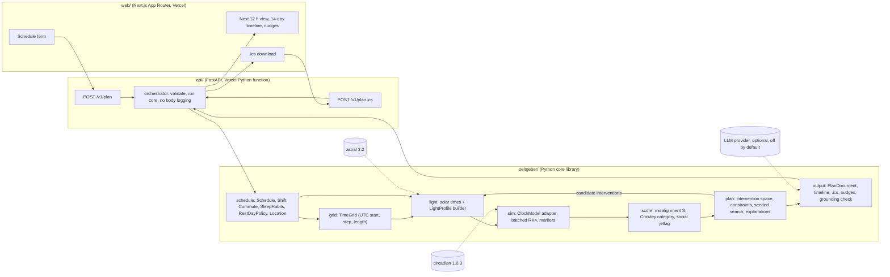

# Zeitgeber architecture

This document describes how the pieces of Zeitgeber fit together, the public interfaces between them, the runtime decision and the numbers behind it, the planner design, the testing strategy, tooling, risks and the build plan. Science inputs (models, constants, rules) are defined in docs/SCIENCE.md and are referenced here by section number.

Conventions: times inside the core are timezone-aware UTC `datetime` values or hours as `float` on a uniform grid; light is photopic lux; phase is radians; durations in hours unless a name says minutes.

## 1. System diagram

Data flow for one request: the web form posts a `Schedule`; the API validates it and calls the core; the core builds the baseline light profile, equilibrates the model on the current habits, scores the baseline, searches the intervention space (each candidate is a new light profile simulated in a batch), explains the chosen interventions by ablation, and renders a `PlanDocument`; the API returns JSON or an .ics file; nothing is stored.
